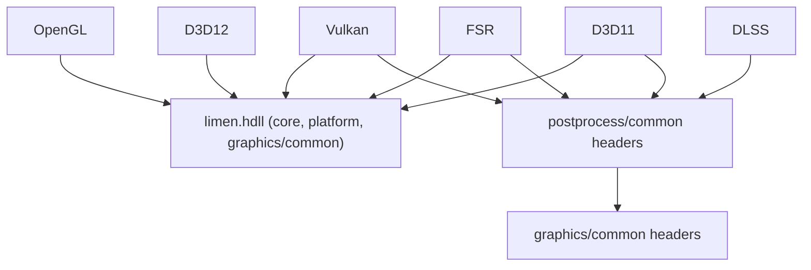

# Native Modules

CMake builds these modules into `limen.hdll` and the optional `.limen` binaries.
Modules with Haxe bindings own their own `src/` classpath. The checkout and
local Haxelib development use the list in [`workspace.hxml`](../workspace.hxml).
See the [Haxe API guide](../docs/HAXE_API.md) for public package names.

```text
graphics/opengl/
  src/limen/opengl/
  native/
  tests/
  CMakeLists.txt
```

| Module | Native responsibilities | Binary |
| --- | --- | --- |
| `core` | HashLink primitives, dynamic module loading, and native CPU jobs | `limen.hdll` |
| `platform` | SDL3 initialization, windows, input, events, displays, and system utilities | `limen.hdll` |
| `graphics/common` | Graphics driver selection, native handles, and the Vulkan requirements contract | `limen.hdll` |
| `graphics/opengl` | OpenGL contexts and rendering | `opengl.limen` |
| `graphics/vulkan` | Vulkan surfaces, rendering, shader compilation, and optional VMA | `vulkan.limen` |
| `graphics/d3d11` | Direct3D 11 rendering | `d3d11.limen` |
| `graphics/d3d12` | Direct3D 12 rendering, diagnostics, and optional D3D12MA | `d3d12.limen` |
| `graphics/metal` | Reserved for Metal | |
| `postprocess/common` | Shared post-processing types | |
| `postprocess/fsr` | AMD FidelityFX Super Resolution | `fsr.limen` |
| `postprocess/dlss` | NVIDIA Streamline DLSS | `dlss.limen` |

## Dependencies

Arrows point from consumers to dependencies. The native loader discovers
`.limen` binaries at runtime, independently of the link graph.



Core uses HashLink and SDL's dynamic loader. Platform owns SDL initialization
and calls Core to unload modules on shutdown. Its SDL window bridge uses Vulkan
SDK headers when Vulkan is enabled. FSR builds its D3D12 and Vulkan adapters
with the corresponding FidelityFX SDKs. DLSS uses Streamline and only needs
Vulkan SDK headers when its Vulkan support is enabled. Renderer binaries link
independently, and a build with all optional modules disabled ships only
`limen.hdll`.

Core jobs run coarse native ranges on persistent workers. A caller can reuse
batch storage when all its waiters have returned. Dependencies refer to
batches already submitted to the same scheduler. Kernels can fork and join
children through their job context. Cancellation skips queued ranges and can
be polled by kernels already running. The scheduler drains and joins at
shutdown. Worker code can borrow pinned pointer-free bytes for a synchronous
call. HashLink objects and SDL events stay on their owning threads.

Heaps builds can opt into DXT asset conversion with `-D heaps_native_jobs`.
`NMB_JOB_WORKERS` controls the pool size. Limen limits it to the available
logical CPUs minus the caller. The experimental rotated sprite kernel has
a separate `-D heaps_native_sprite_jobs` build define.
Large Heaps Worlds can opt into native frustum culling with
`-D heaps_native_world_culling`. The same worker setting is shared
with the other native workloads. Heaps owns the culling snapshot and
applies visibility after the workers join.

In Haxe, platform-only code uses `platform/src` and `graphics/common/src`.
OpenGL adds its own classpath. Vulkan, D3D11, and D3D12 also use
`postprocess/common/src` for shared descriptors. Each renderer owns its
handle conversions. FSR and DLSS use D3D12 types in their D3D12-specific
calls, and DLSS uses the Vulkan requirements type for Vulkan initialization.

Each module keeps its native implementation in `native/` and its tests in
`tests/`. Shared checks live in the [root test directory](../tests).
Build and test from the repository root using the
[launcher](../README.md#build-and-test-selected-modules), or run CTest with
`-L <module>` after enabling `LIMEN_BUILD_TESTS` in CMake.

## Adding a native module

1. Add the module under the relevant subsystem and give it its own
   `CMakeLists.txt`. Register its primitive sources with
   `limen_register_module()` before checking its build option. Enabled modules
   use `limen_add_module()` and declare their own dependencies and compile flags.
2. Add the option and target restrictions to [Options.cmake](../cmake/Options.cmake),
   include the module from the root CMake file, and add its name and dependency
   rules to [build.py](../tools/build.py). Use `limen_stage_runtime()` for SDK
   binaries so they are copied, installed, and checked with the package.
3. Put Haxe bindings in the module's `src/limen/` package and add its `src/`
   classpath to [`workspace.hxml`](../workspace.hxml).
4. Keep module-specific tests beside the module. Register them in the
   [test entry point](../tests/CMakeLists.txt) and label them with the module name.
   Verify the isolated selection and add relevant CI coverage.
