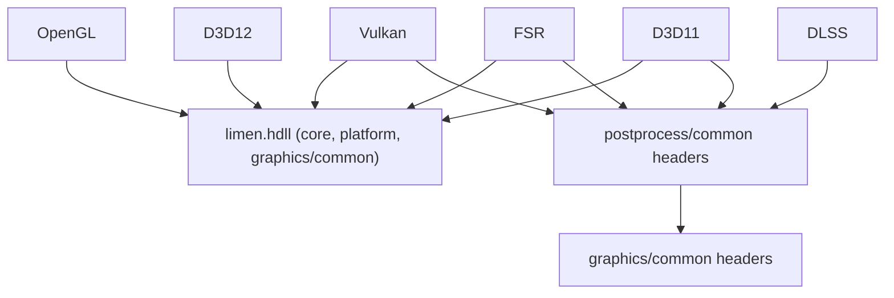
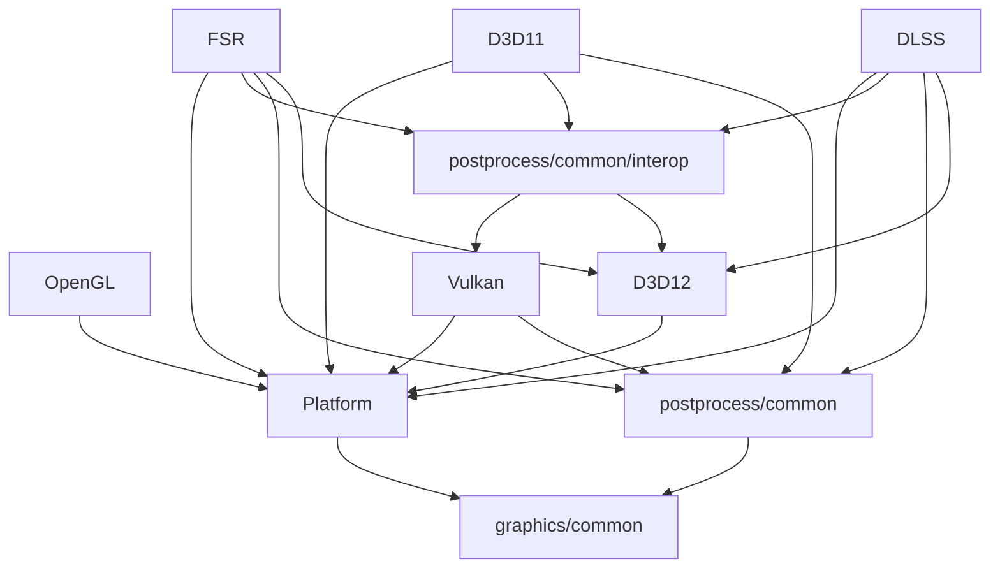

# Native Modules

CMake builds these modules into `limen.hdll` and the optional `.limen` binaries.
Haxe sources live in each module's `haxe/` classpath. The public package
names are documented in the [Haxe API guide](../docs/HAXE_API.md).

| Module | Native responsibilities | Binary |
| --- | --- | --- |
| `core` | HashLink primitives and dynamic module loading | `limen.hdll` |
| `platform` | SDL3 initialization, windows, input, events, displays, and system utilities | `limen.hdll` |
| `graphics/common` | Graphics driver selection, native handles, and the Vulkan requirements contract | `limen.hdll` |
| `graphics/opengl` | OpenGL contexts and rendering | `opengl.limen` |
| `graphics/vulkan` | Vulkan surfaces, rendering, shader compilation, and optional VMA | `vulkan.limen` |
| `graphics/d3d11` | Direct3D 11 rendering | `d3d11.limen` |
| `graphics/d3d12` | Direct3D 12 rendering, diagnostics, and optional D3D12MA | `d3d12.limen` |
| `graphics/metal` | Reserved for Metal | |
| `postprocess/common` | Shared post-processing types | |
| `postprocess/fsr` | AMD FidelityFX Super Resolution | `fsr.limen` |
| `postprocess/dlss` | NVIDIA Streamline DLSS | `dlss.limen` |

The Haxe runtime entry point, `limen.platform.Platform`, lives in `platform`.

## Dependencies

Arrows point from consumers to dependencies. The native loader discovers
`.limen` binaries at runtime, independently of the link graph.

Core uses HashLink and SDL's dynamic loader. Platform owns SDL initialization
and calls Core to unload modules on shutdown. Its SDL window bridge uses Vulkan
SDK headers when Vulkan is enabled. FSR builds its D3D12 and Vulkan adapters
with the corresponding FidelityFX SDKs. DLSS uses Streamline and only needs
Vulkan SDK headers when its Vulkan support is enabled. Renderer binaries link
independently, and a build with all optional modules disabled ships only
`limen.hdll`.

The Haxe classpaths have a separate dependency graph.

Platform uses shared graphics driver IDs. Vulkan and D3D11 use shared
postprocessing descriptors, whose native handle types are defined in
`graphics/common`. Legacy renderer imports still resolve to those same types.
The separate `postprocess/common/interop/haxe` classpath contains
`CommandBuffer`, which depends on the existing typed D3D12 and Vulkan command
APIs. Vulkan entry points use the descriptor classpath directly. D3D11 uses
`CommandBuffer` for `getPostProcessCommands()`. FSR and DLSS use it for
dispatch and retain the D3D12 declarations required by their typed swapchain,
queue, and frame-generation calls. Their Haxe declarations are available in
the same Haxelib distribution across native build configurations.

Each module keeps its native implementation in `native/` and any native tests
in `tests/`. Configure and build from the repository root using the existing
[build commands](../README.md#quick-build). The root CMake project resolves shared
dependencies and configures the modules. Each backend CMake file registers its
primitive sources with `limen_register_module()` even when its build option
is disabled so applications can still load the core HashLink proxies. Enabled
backends use `limen_add_module()` and declare their own build dependencies.

When adding a module's first Haxe source, add its `haxe/` directory to
[`workspace.hxml`](../workspace.hxml). The workspace and Haxelib development
mode share this list, and the packager checks it against the source tree.
